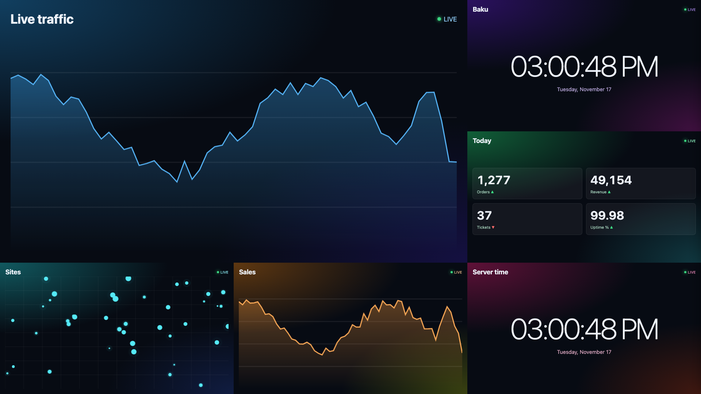
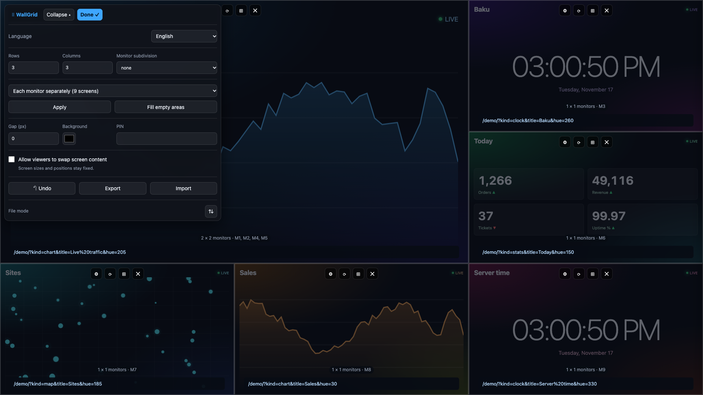
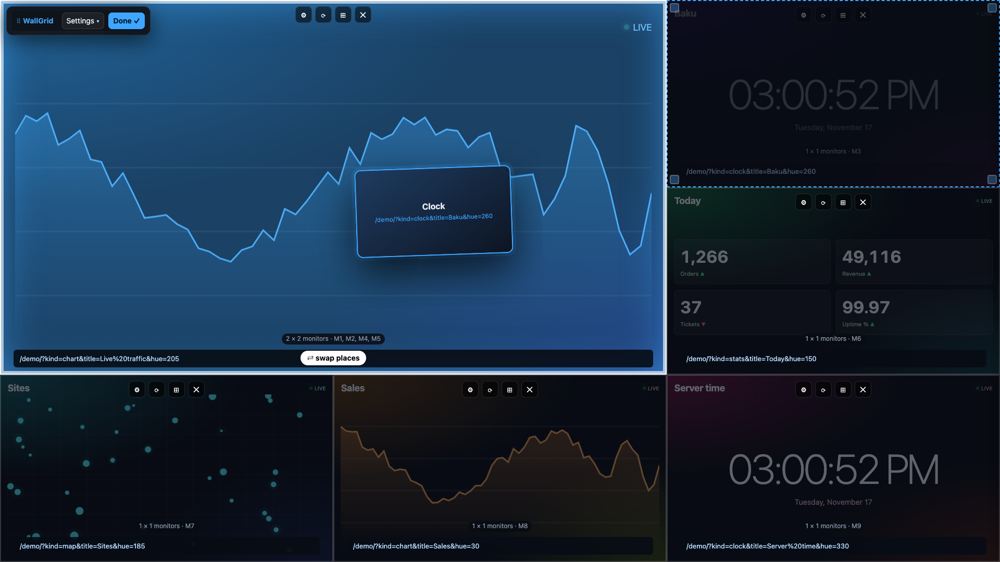
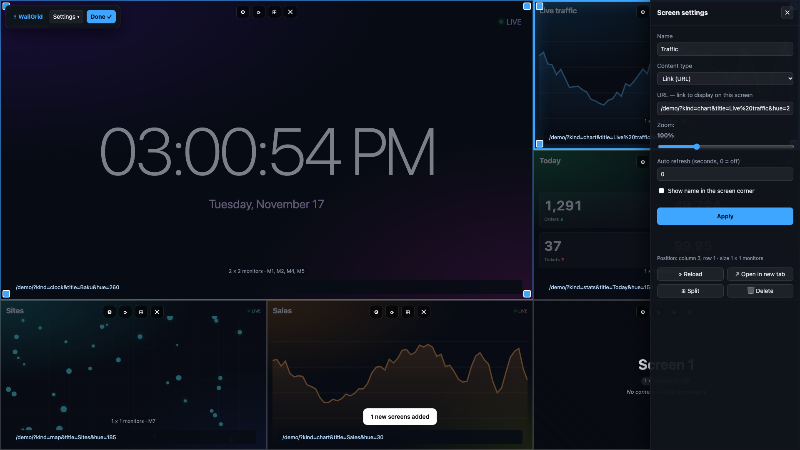

<div align="center">

# ▦ WallGrid

**Turn a grid of monitors into one configurable video wall.**
Split, merge and drag screens around, and point each one at any web page. No build step, no dependencies.


🇦🇿 [Azərbaycanca təlimat](docs/README.az.md)



</div>

---

## Why

Control rooms, offices and shop floors often have a wall of 4, 9 or 16 displays driven by a single PC. Arranging dashboards on them usually means juggling browser windows by hand. WallGrid runs as **one full-screen browser page** that covers the whole wall and divides it into screens. Each screen is an `iframe` showing whatever URL you give it. The layout is saved to a JSON file, so the wall comes back exactly the same after a reboot.

## Features

- **Any grid.** 3×3 today, 4×4 or 3×4 tomorrow (up to 16×16). Change rows/columns at any time; new monitors are filled in automatically.
- **Any split.** Merge monitors by dragging a screen's corner, split them back with one click, or draw a new screen across empty cells. Optional sub-division lets a single monitor hold 2×2, 3×3 or 4×4 screens.
- **Drag & drop with motion.** Drop a screen onto another to swap places (even different sizes) or onto free space to move it. Pages keep running while they move, with a smooth FLIP animation.
- **Layout presets.** Generated for the current grid: one per monitor, whole wall, rows, columns, big + edges, center focus, halves, quadrants…
- **Per-screen settings.** URL or pasted `<iframe>` embed code, zoom (25–300 %), auto-refresh interval, optional title badge, loading indicator.
- **Hidden editor.** The wall shows only content. Open the editor at `/edit`, via the top-left hot corner or <kbd>Ctrl</kbd>+<kbd>Shift</kbd>+<kbd>E</kbd>. Optional PIN.
- **Persistent & synced.** Saved to `data/config.json` (with an automatic backup). Other open walls pick up changes within ~5 seconds, so you can edit from a laptop.
- **Viewer content swap.** Optionally let people swap what two screens show without entering the editor.
- **Undo, export, import.** <kbd>Ctrl</kbd>+<kbd>Z</kbd>, plus JSON export/import for moving a setup between machines.
- **Multilingual UI.** English, Azerbaijani and Russian; translations live in plain JSON files.
- **Kiosk launchers.** `start.sh` (macOS/Linux) and `start.bat` (Windows) start the server and open Chrome full screen.

## Screenshots

| Edit mode | Drag & drop |
|---|---|
|  |  |

<details>
<summary>Screen settings drawer</summary>



</details>

## Quick start

Requires [Node.js](https://nodejs.org) 18 or newer. There is nothing to install.

```bash
git clone https://github.com/karimovnijat/WallGrid.git
cd WallGrid
npm start            # or: node server.js
```

| | |
|---|---|
| Wall | http://127.0.0.1:8080/ |
| Editor | http://127.0.0.1:8080/edit |

The first run opens a **demo layout** with built-in live tiles, so you can try dragging and merging right away. Replace the URLs with your own dashboards.

### Run it on the wall (kiosk)

```bash
./start.sh           # macOS / Linux
start.bat            # Windows
```

Both start the server and open Chrome in kiosk mode with its own profile (`.chrome-profile/`).

> **Note:** WallGrid divides the browser window; it doesn't arrange your physical displays. Configure the monitors as one large desktop first (e.g. NVIDIA Mosaic, AMD Eyefinity or your OS display settings). If they can't be merged into one display, give Chrome an exact window size instead:
>
> ```bash
> WALL_W=5760 WALL_H=3240 ./start.sh
> ```

## Using the editor

| Action | How |
|---|---|
| Open screen settings | Click a screen (or its ⚙ button) |
| Swap two screens | Drag one onto the other |
| Move to free space | Drag onto empty cells; a green preview shows where it lands |
| Resize / merge | Drag any corner; screens fully inside the new area are merged |
| Split | ⊞. A multi-monitor screen splits into monitors, a single one into its sub-cells |
| New screen | Draw across empty cells, or use **Fill empty areas** |
| Delete | ✕, or <kbd>Delete</kbd> on the selected screen |
| Undo | <kbd>Ctrl</kbd>/<kbd>⌘</kbd>+<kbd>Z</kbd> |
| Leave the editor | **Done ✓** or <kbd>Esc</kbd> |

Each screen card shows which physical monitors it covers, e.g. `2 × 2 monitors · M1, M2, M4, M5`.

## Configuration

Everything lives in `data/config.json`. The editor writes it for you, but it is plain JSON and safe to edit by hand:

```jsonc
{
  "language": "en",                      // en | az | ru
  "grid":  { "rows": 3, "cols": 3, "sub": 1 },   // sub: cells per monitor side (1–4)
  "style": { "gap": 0, "background": "#000000" }, // gap in px, e.g. to compensate bezels
  "security": { "pin": "" },             // empty = editor opens without a PIN
  "allowSourceSwap": false,              // let viewers swap screen content
  "panels": [
    {
      "id": "traffic",
      "title": "Traffic",
      "x": 0, "y": 0, "w": 2, "h": 2,    // position and size in grid units
      "sourceType": "url",               // url | embed
      "url": "https://example.com/dashboard",
      "embedCode": "",
      "zoom": 100,                       // percent
      "refresh": 0,                      // seconds, 0 = never
      "showTitle": false
    }
  ]
}
```

Coordinates are in **units**: one monitor is `sub × sub` units, so on a 3×3 wall with `sub: 2` the grid is 6×6. Invalid or overlapping panels are dropped when the file is loaded.

### Environment variables

| Variable | Default | Purpose |
|---|---|---|
| `PORT` | `8080` | HTTP port |
| `HOST` | `127.0.0.1` | Use `0.0.0.0` to manage the wall from other machines on the network |
| `WALL_W`, `WALL_H` | not set | Exact Chrome window size for the launch scripts (instead of kiosk mode) |

### Demo tiles

`/demo/` is a small self-contained page for testing without external sites:

```
/demo/?kind=clock&title=Baku&hue=260
/demo/?kind=chart&title=Sales&hue=30
/demo/?kind=stats&title=Today&hue=150
/demo/?kind=map&title=Sites&hue=185
```

### Adding a language

Copy `public/lang/en.json`, translate the values (keep the keys), add the code to the language list in `public/js/i18n.js` and `public/js/layout.js`, and add an `<option>` to the language selector in `public/index.html`.

## How it works

```
server.js            zero-dependency Node HTTP server: static files + GET/PUT /api/config
public/
  index.html         the wall, editor toolbar and settings drawer
  css/style.css
  js/layout.js       pure layout logic: grid units, presets, merge/split, validation
  js/store.js        persistence (server file, falls back to localStorage)
  js/i18n.js         tiny translation layer
  js/app.js          rendering, drag & drop, FLIP animations, editor UI
  lang/*.json        UI translations
  demo/              built-in demo tiles
data/
  config.example.json  first-run demo layout (config.json is created on first save)
```

The wall is a CSS grid. Each screen is placed with `grid-column` / `grid-row` spans, so moving a screen only changes its grid position and the `iframe` is never reloaded. Writes are atomic (temp file + rename), and the previous version is kept as `config.backup.json`.

## Good to know

- **Some sites refuse to be embedded.** Sites that send `X-Frame-Options` or a `frame-ancestors` CSP (many search engines, banks, social networks) show a blank screen. Use the site's official embed URL, or allow framing on dashboards you control.
- **The PIN is a convenience lock, not authentication.** When running with `HOST=0.0.0.0`, anyone on the network can reach the API. Only expose it on a trusted network.
- **Opening `index.html` directly** (without the server) works, but the layout is then kept in the browser's localStorage only. Use Export / Import to move it.

## Contributing

Issues and pull requests are welcome. The project intentionally has no build step and no dependencies, so please keep it that way.
